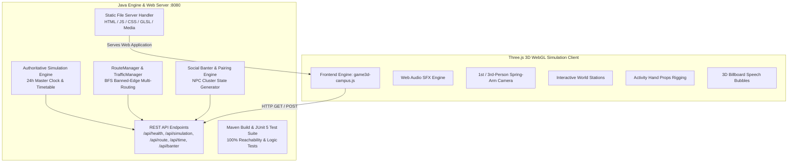

# ANHS Campus Simulation — Java-First Master Improvement Roadmap

This folder contains the complete, exhaustive engineering plans for migrating the entire backend server to **Java (JDK 17+)** and subsequently upgrading the 3D Campus Simulation, AI Agent Engine, and World Interactivity.

---

## 🏛️ Java-First Master Architecture

The Node.js server (`server.js`) will be completely phased out in favor of a **high-performance, pure Java backend server** (`java-server/`) that serves both static web assets and authoritative simulation logic.

---

## 📑 Roadmap Phases (Java-First Progression)

| Document | Phase Title | Focus Area |
|---|---|---|
| [PHASE_1_JAVA_BACKEND_MIGRATION.md](file:///h:/HARSH_PROJECTS/PERSONAL%20PROJECT/cote/improvement/PHASE_1_JAVA_BACKEND_MIGRATION.md) | **Phase 1: Complete Java Backend Migration & Build System** | • Unified Java Static Web Server + Simulation Engine on port `8080`. • Maven `pom.xml` build configuration & executable JAR packaging. • Automated JUnit 5 test suite covering graph reachability, routing, and traffic. |
| [PHASE_2_ATMOSPHERE_AND_AUDIO.md](file:///h:/HARSH_PROJECTS/PERSONAL%20PROJECT/cote/improvement/PHASE_2_ATMOSPHERE_AND_AUDIO.md) | **Phase 2: Atmosphere, Web Audio SFX & Astronomical Lighting** | • Procedural Web Audio Engine (Westminster period chimes, surface-aware footsteps, spatial audio). • 24-Hour Orbital Sun & Night Lighting driven by Java simulation clock. • Codebase cleanup and alignment of `3d-game/`. |
| [PHASE_3_WORLD_INTERACTION_AND_CAMERA.md](file:///h:/HARSH_PROJECTS/PERSONAL%20PROJECT/cote/improvement/PHASE_3_WORLD_INTERACTION_AND_CAMERA.md) | **Phase 3: World Interactivity & 3rd-Person Camera** | • Third-Person Over-The-Shoulder Camera (`V` / `F5`) with spring-arm wall collision avoidance. • Interactive World Stations (Desk seating, Dorm bed sleep/rest with Java time fast-forward). • Activity Hand Props (Books, lunch trays, basketballs, coffee cups). |
| [PHASE_4_AI_SOCIAL_AND_PROPS.md](file:///h:/HARSH_PROJECTS/PERSONAL%20PROJECT/cote/improvement/PHASE_4_AI_SOCIAL_AND_PROPS.md) | **Phase 4: Social AI & Java-Driven Dynamic Banter** | • Java-driven NPC-to-NPC Social Banter Engine & conversational clustering. • 3D Billboard Speech Bubbles with theme accents and auto-fade timers. • Authoritative Two-Way State Synchronization between Java Engine and 3D Client. |

---

## 🎯 Engineering Standards for All Phases

1. **Pure Java Backend (No Node.js Dependency)**:
   - The entire stack must be launchable with standard Java tooling (`mvn exec:java` or `java -jar cote-server.jar`).
   - Zero external runtime dependencies beyond JDK 17+ and JUnit 5 for tests.
2. **Authoritative Server Architecture**:
   - The Java backend serves as the single source of truth for the 24-hour master clock, timetable transitions, route solving, and seat reservations.
   - The JavaScript client focuses on high-framerate Three.js rendering, camera control, audio synthesis, and visual interpolation.
3. **Continuous Verification**:
   - Every backend capability must be verified with automated JUnit 5 tests before integration with the 3D frontend.
